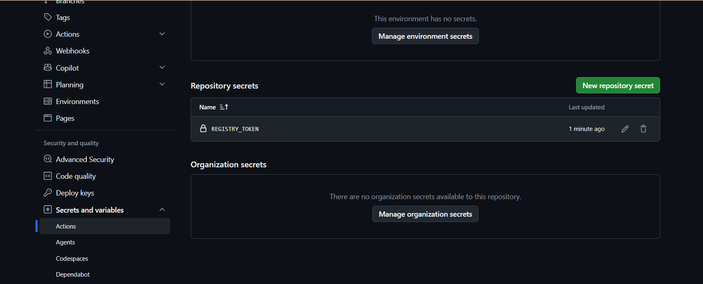

# Bài tập 4: Khai báo GitHub Secrets và cấu hình Đăng nhập Container Registry

- **Môn học:** IT215 - Cloud Infrastructure & DevOps Fundamentals
- **Học viên:** Trần Đức Anh
- **Đường dẫn nộp bài:** `homework/session_11/ex4/`

---

## 1. Mục tiêu

- Tạo Personal Access Token (classic) trên GitHub với quyền thao tác gói Container (`write:packages`).
- Cấu hình bí mật bảo mật cấp kho lưu trữ (Repository Secret) với tên biến `REGISTRY_TOKEN` trên GitHub.
- Cấu hình bước tự động xác thực đăng nhập vào GitHub Container Registry (GHCR) trong workflow GitHub Actions bằng `docker/login-action@v3`.

---

## 2. Cấu trúc thư mục dự án

```text
ss11/ex4/
├── .github/
│   └── workflows/
│       └── ci.yml
├── gradle/
│   └── wrapper/
│       ├── gradle-wrapper.jar
│       └── gradle-wrapper.properties
├── src/
│   ├── main/java/com/example/ex11/Ex11Application.java
│   └── test/java/com/example/ex11/Ex11ApplicationTests.java
├── build.gradle
├── ci-ex4-ss11.png
├── gradlew
├── gradlew.bat
├── settings.gradle
├── .gitignore
└── README.md
```

---

## 3. Nội dung tệp kịch bản CI Workflow (`.github/workflows/ci.yml`)

```yaml
name: Java Spring Boot CI (Gradle)

on:
  push:
    branches: [ "main" ]

jobs:
  test:
    name: Run Unit Tests and Build JAR
    runs-on: ubuntu-latest

    steps:
      - name: Checkout mã nguồn
        uses: actions/checkout@v5

      - name: Thiết lập môi trường Java JDK 17
        uses: actions/setup-java@v5
        with:
          java-version: '17'
          distribution: 'temurin'
          cache: 'gradle'

      - name: Cấp quyền cho Gradle Wrapper
        run: chmod +x gradlew

      - name: Thực thi JUnit Test với Gradle
        run: ./gradlew test

      - name: Đóng gói tệp JAR với Gradle
        run: ./gradlew bootJar

      - name: Lưu trữ thành phẩm JAR Artifact
        uses: actions/upload-artifact@v4
        with:
          name: app-jar
          path: build/libs/*.jar

      - name: Đăng nhập vào GitHub Container Registry
        uses: docker/login-action@v3
        with:
          registry: ghcr.io
          username: ${{ github.actor }}
          password: ${{ secrets.REGISTRY_TOKEN }}
```

---

## 4. Các bước cấu hình Secret trên GitHub

1. **Khởi tạo Personal Access Token:**
   - Truy cập **GitHub Settings** -> **Developer Settings** -> **Personal access tokens** -> **Tokens (classic)**.
   - Nhấn **Generate new token (classic)**, đặt tên token (ví dụ: `ghcr-token`).
   - Tích chọn quyền: `write:packages`, `read:packages`.
   - Copy mã token vừa sinh.

2. **Cấu hình Repository Secret:**
   - Tại Repository dự án, mở mục **Settings** -> **Secrets and variables** -> **Actions**.
   - Nhấn **New repository secret**.
   - Điền Name: `REGISTRY_TOKEN`.
   - Điền Secret: dán mã token vừa copy và nhấn **Add secret**.

---

## 5. Minh chứng cấu hình Repository Secrets

Ảnh chụp màn hình thực tế mục **Repository secrets** trên GitHub hiển thị biến `REGISTRY_TOKEN` đã được tạo thành công:



### Chi tiết:
- **Vị trí cấu hình:** `Settings` -> `Secrets and variables` -> `Actions` -> `Repository secrets`.
- **Tên bí mật (Name):** `REGISTRY_TOKEN`.
- **Trạng thái:** Đã lưu trữ an toàn, được mã hóa tự động bởi GitHub Secrets.

---

## 6. Giải thích bước đăng nhập Container Registry

- **`uses: docker/login-action@v3`**: Action chính thức từ Docker hỗ trợ đăng nhập an toàn vào các hệ thống Docker Registry (Docker Hub, GHCR, AWS ECR, GCP Artifact Registry).
- **`registry: ghcr.io`**: Chỉ định đích đăng nhập là GitHub Container Registry.
- **`username: ${{ github.actor }}`**: Tự động lấy username của người kích hoạt workflow hoặc chủ sở hữu repository (`TranDucAnh3103`).
- **`password: ${{ secrets.REGISTRY_TOKEN }}`**: Lấy giá trị token bảo mật được mã hóa từ Repository Secrets mà không làm lộ thông tin nhạy cảm trong mã nguồn hay log chạy.

---

## 7. Kết quả kiểm tra

Sau khi đẩy mã nguồn lên nhánh `main`, GitHub Actions thực thi bước đăng nhập:
```text
Run docker/login-action@v3
  with:
    registry: ghcr.io
    username: TranDucAnh3103
    password: ***
    logout: true
Logging into ghcr.io...
Login Succeeded!
```
- Trạng thái step hiển thị tích xanh thành công (`Login Succeeded!`).
- Token được GitHub tự động che (mask) thành dấu `***`, đảm bảo an toàn tuyệt đối.

---

## 8. Kết luận

- Biến bí mật `REGISTRY_TOKEN` đã được khởi tạo thành công và bảo mật chuẩn hóa.
- Workflow CI đã thực hiện xác thực tự động tới GitHub Container Registry (GHCR), sẵn sàng cho quy trình build và đẩy Docker Image ở các bài tiếp theo.
